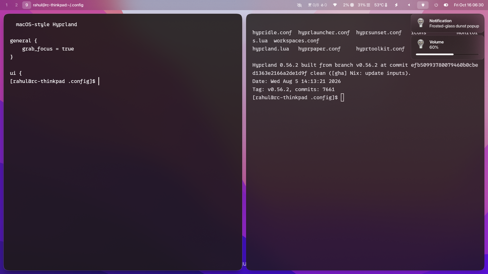

# My Hyprland configuration

A macOS-inspired ("Golden Gate") desktop for [Hyprland](https://hypr.land) on Arch Linux: frosted-glass blur, squircle corners, a translucent menu bar, soft spring animations, and matching terminal / notifications / launcher.



The repo holds only files I actually configured; app defaults, caches, browser profiles and state are left out. Everything lives under `.config/` so it maps 1:1 onto `~/.config`.

## What's inside

| Path | What it does |
| --- | --- |
| `hypr/hyprland.lua` | Main config (Hyprland ≥ 0.55 **Lua** config): look & feel, blur, animations, binds, window/layer rules |
| `hypr/monitors.lua`, `monitors.conf` | Monitor layout, generated by `nwg-displays` — **edit for your outputs** |
| `hypr/hypridle.conf` | Dim after 2 min, screen off after 10 min |
| `hypr/hyprpaper.conf` | Wallpaper (`~/Pictures/wall.jpeg`) |
| `hypr/hyprsunset.conf` | Night light: neutral at 07:30, 5500 K at 19:30 |
| `hypr/hyprlauncher.conf`, `hyprtoolkit.conf` | Spotlight-style launcher theme |
| `hypr/scripts/` | Volume / brightness (laptop + external DDC/CI) / idle-dim helpers that raise OSD popups via dunst |
| `hypr/icons/` | SVG icons used by those OSDs |
| `waybar/` | macOS menu-bar style bar, plus custom modules (below) |
| `kitty/kitty.conf` | Translucent warm-dark terminal with macOS accent colors |
| `dunst/` | Frosted notifications with progress bars and a notification sound script |

### Waybar extras

- **Focus blocks** (`focus-block.sh`) — 8 × 45 min work blocks with 15 min breaks, daily count and weekday streak. Left click start/pause, right click cancel, middle click opens a progress link (set your own URL in `config.jsonc`).
- **Privacy dots** (`privacy-dots.sh`) — green = camera, orange = microphone, purple = screen share / system-audio capture, like macOS.
- **Control drawer** (`perf-top.sh`) — click to reveal CPU, memory, temperature, power profile, volume, brightness, battery and power menu.
- **Audio output picker** (`audio-output-menu.py`) — GTK layer-shell dropdown to switch the default sink.
- **Power menu** (`power_menu.xml`) — Sleep / Hibernate / Restart / Shut Down.

## Key bindings

`SUPER` is the main modifier.

| Keys | Action |
| --- | --- |
| `SUPER + Q` | Terminal (kitty) |
| `SUPER + C` | Close window |
| `SUPER + E` | File manager (dolphin) |
| `SUPER + R` | Launcher (hyprlauncher) |
| `SUPER + V` / `F` / `P` / `J` | Float / fullscreen / pseudo / toggle split |
| `SUPER + arrows` | Move focus |
| `SUPER + 1…0` (+`SHIFT`) | Go to workspace (move window) |
| `SUPER + S` (+`SHIFT`) | Toggle scratchpad (send window to it) |
| `SUPER + LMB / RMB` | Drag / resize window |
| `SUPER + M` | Exit Hyprland |
| `PRINT` / `SUPER+PRINT` / `SHIFT+PRINT` | Screenshot region / window / monitor (hyprshot) |
| `CTRL + ALT + ↑/↓` | External monitor brightness (ddcutil) |
| Media / volume / brightness keys | Handled via scripts with OSD popups |
| 3-finger swipe | Switch workspace |

## Dependencies

Arch package names:

```
hyprland hyprpaper hypridle hyprsunset hyprlauncher hyprshot
waybar dunst kitty brightnessctl ddcutil playerctl wireplumber pipewire-pulse
libnotify jq libpulse python-gobject gtk-layer-shell nwg-displays dolphin
```

Fonts: **SF Pro** (UI) and **0xProto Nerd Font** (terminal/icons). Both are referenced by name, so install them or change `font_family` in `kitty.conf`, `style.css`, `dunstrc` and `hyprtoolkit.conf`.

Optional: `xscreensaver` (the `SUPER + T` clock saver), `pavucontrol`.

## Install

Back up your existing config first, then review and copy what you want:

```bash
git clone https://github.com/rhlc/my-hyprland-config
cd my-hyprland-config
cp -a .config/. "$HOME/.config/"
```

Then:

1. Put a wallpaper at `~/Pictures/wall.jpeg` (not included).
2. Edit `hypr/monitors.lua` (or run `nwg-displays`) for your outputs — mine disables the laptop panel and drives an HDMI monitor at 1.25 scale.
3. Adjust `temperature.hwmon-path-abs` in `waybar/config.jsonc` if you're not on an Intel `coretemp` CPU, and the `timezones` in the clock module.
4. Log in to Hyprland. `waybar`, `hyprpaper`, `hyprsunset` and `hypridle` are started from `hyprland.lua`.

> `hyprland.lua` uses the newer Lua config format. If you're on an older Hyprland that reads `hyprland.conf`, it won't load.

## Tweaking the look

- **Blur / corners / shadows:** `decoration` block in `hyprland.lua`.
- **Animations:** the `mac*` curves and `hl.animation` list in `hyprland.lua`.
- **Bar colors & spacing:** `waybar/style.css`.
- **Terminal palette:** `color0…15` in `kitty.conf`.

## Notes

Scripts reference `~/.config/...` paths and assume the tools above. Nothing here contains secrets.
